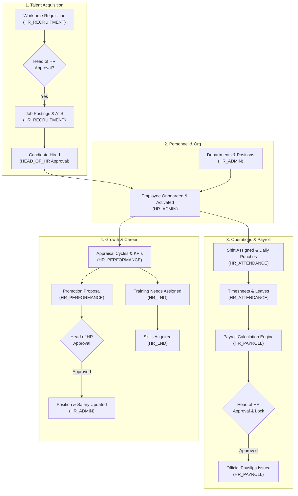
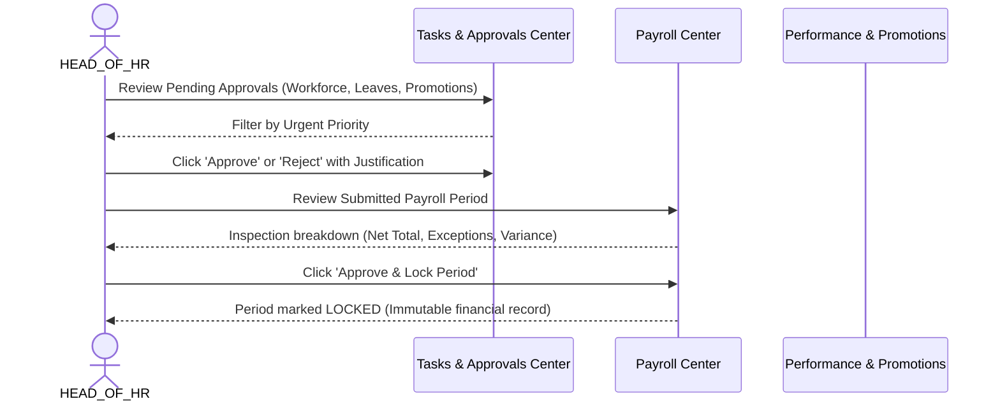
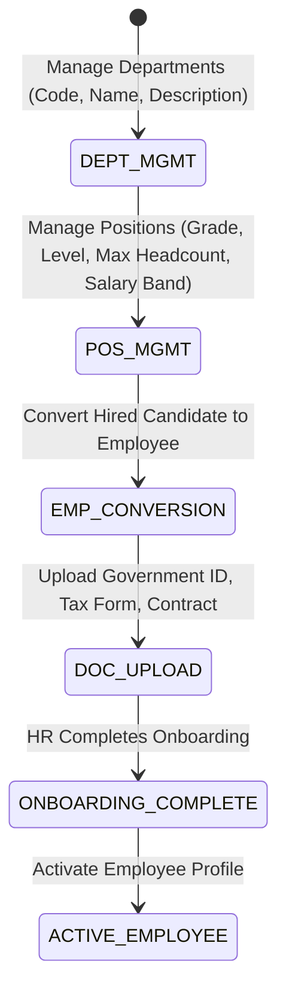
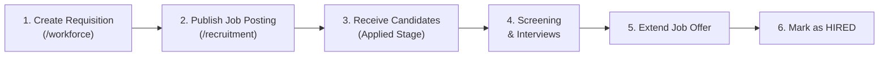
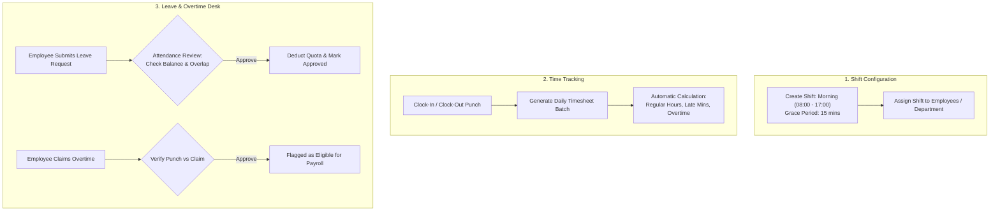
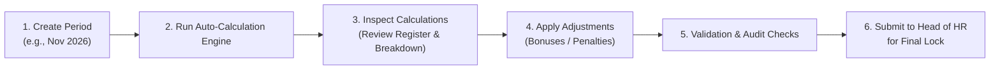
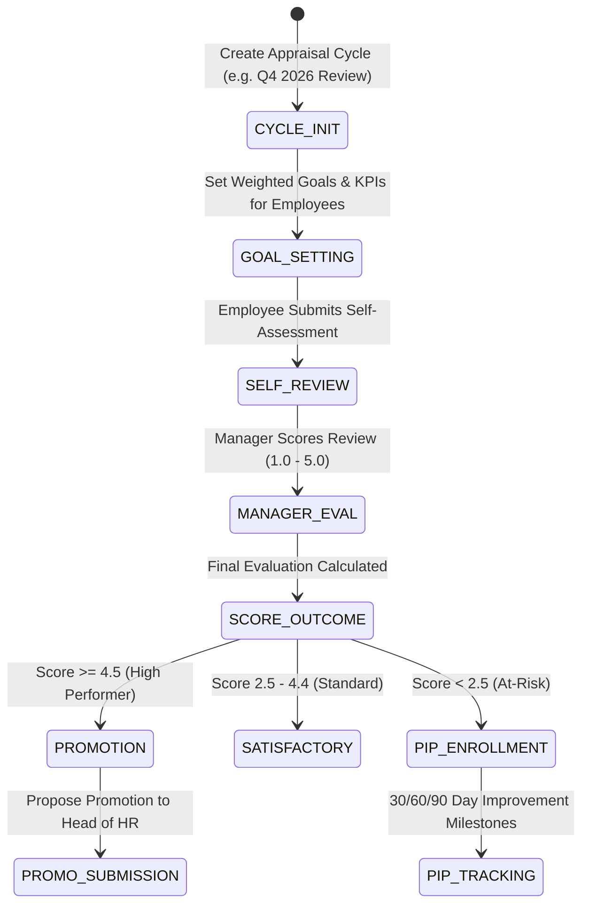
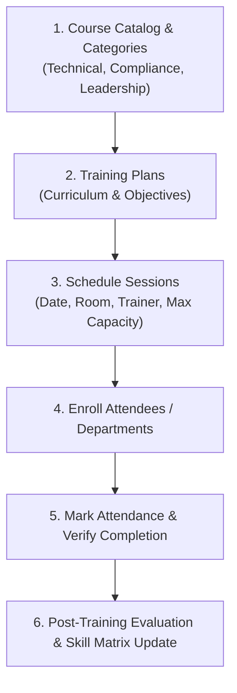

# HRMS Enterprise: Comprehensive Role-Based Workflow Guide

This guide details the complete operational lifecycle, access permissions, user journeys, and cross-module workflows for each of the **7 specialized HR officer roles** in the Enterprise Human Resources Management System (HRMS).

---

## 1. Quick Reference: System Roles & Credentials

All test accounts share the default password: **`password123`**.

| Role Identifier | Seeded Email | Password | Allowed Sidebar Routes | Primary Operational Domain |
| :--- | :--- | :--- | :--- | :--- |
| **`HEAD_OF_HR`** | `head@hr.local` | `password123` | **All Routes** (Dashboard, Tasks, Organization, Workforce, Recruitment, Employees, Attendance, Payroll, Performance, L&D, Users, Audit Logs, Data Logs) | Executive leadership, final workflow approvals, budget sign-off, system-wide governance. |
| **`HR_ADMIN`** | `admin@hr.local` | `password123` | `/dashboard`, `/tasks`, `/organization`, `/workforce`, `/employees`, `/users`, `/audit-logs`, `/data-logs` | Department structure, position catalog, employee lifecycle, document onboarding, user administration, and audit records. |
| **`HR_RECRUITMENT`** | `recruiter@hr.local` | `password123` | `/dashboard`, `/tasks`, `/workforce`, `/recruitment` | Talent acquisition, headcount requisitions, job postings, candidate pipelines (ATS), and interview panels. |
| **`HR_ATTENDANCE`** | `attendance@hr.local` | `password123` | `/dashboard`, `/tasks`, `/attendance` | Shift scheduling, clock-in punches, daily timesheets, leave approvals, and overtime audits. |
| **`HR_PAYROLL`** | `payroll@hr.local` | `password123` | `/dashboard`, `/tasks`, `/payroll` | Pay cycles, automated gross-to-net computation engine, salary adjustments, tax/deduction audits, and payslips. |
| **`HR_PERFORMANCE`** | `performance@hr.local` | `password123` | `/dashboard`, `/tasks`, `/performance` | Appraisal cycles, KPI & goal tracking, 360 review scoring, PIP interventions, and promotion proposals. |
| **`HR_LND`** | `lnd@hr.local` | `password123` | `/dashboard`, `/tasks`, `/lnd` | Training catalog, course programs, batch session scheduling, employee attendance, and skill matrices. |

---

## 2. Cross-Role Collaboration & Enterprise Data Pipelines

The system is designed so that each department seamlessly feeds data into subsequent stages:

---

## 3. Individual Role Deep-Dives & Testing Flows

---

### Role 1: `HEAD_OF_HR` (Executive Leadership & Final Sign-Off)
- **Login**: `head@hr.local` / `password123`
- **Purpose**: Master administrator with complete read/write access. Serves as the ultimate approval authority for headcount, final hiring, payroll locks, promotions, and organizational governance.

#### Hands-On Testing Flow
1. **Executive Dashboard (`/dashboard`)**:
   - View top-level enterprise KPIs: Total Headcount, Active Requisitions, Pending Leaves, and Monthly Payroll Expense.
2. **Executive Review Desk (`/tasks`)**:
   - Switch to **Pending Approvals** tab to view requests submitted by other HR officers.
   - Click **View** on a pending Workforce Request or Leave Request to inspect details in the drawer.
   - Click **Approve** (green button) or **Reject** (red button with mandatory reason modal).
3. **Payroll Final Sign-Off (`/payroll`)**:
   - Go to `/payroll` $\rightarrow$ **Period Manager** tab.
   - When a period is in `SUBMITTED` state, the **Approve & Lock** button becomes active.
   - Click **Approve & Lock** to finalize the period. Once locked, records cannot be altered.
4. **User Administration (`/users`)**:
   - View directory of system users, create new officer accounts, and assign/revoke roles.
5. **Audit & System Data Logs (`/audit-logs`, `/data-logs`)**:
   - Search immutable security audit trails by actor, IP address, and mutation type.
   - Use the real-time Data Logs tab to inspect API request payloads and response envelopes.

---

### Role 2: `HR_ADMIN` (Organization & Workforce Records)
- **Login**: `admin@hr.local` / `password123`
- **Purpose**: Controls structural blueprints (Departments & Positions), employee lifecycles, personnel records, and official onboarding compliance documents.

#### Hands-On Testing Flow
1. **Departments & Positions (`/organization`)**:
   - Click **Add Department**: Provide Code (e.g. `MKT`), Name (`Marketing`), and Description.
   - Switch to the **Positions** tab and click **Create Position**:
     - Select Department (`Marketing`), enter Title (`Digital Marketer`), Level (`L2`), Min Salary (`$3,000`), Max Salary (`$4,500`), and Max Headcount (`3`).
     - *Built-in validation*: Note that setting Max Salary lower than Min Salary triggers an immediate Zod/AntD validation block.
2. **Employee Directory (`/employees`)**:
   - View employee roster with search and status filters (`PROBATION`, `ACTIVE`, `TERMINATED`).
   - Click on an employee row to open the **Employee Detail Drawer**:
     - View employment history, current salary grade, and emergency contacts.
     - Switch to the **Documents** tab and test uploading a file (e.g. `Employment_Contract.pdf`).
     - Click **Complete Onboarding** and **Activate Employee**.
3. **User Administration & Audit Logs (`/users`, `/audit-logs`)**:
   - Create accounts for new officers via **Create User** modal.
   - Assign roles with **Assign Role** modal.
   - Inspect security changes in the Audit Logs table.

---

### Role 3: `HR_RECRUITMENT` (Talent Acquisition & ATS Pipeline)
- **Login**: `recruiter@hr.local` / `password123`
- **Purpose**: Solves staffing needs through headcount planning, public job listings, applicant stage progression, and interview scheduling.

#### Hands-On Testing Flow
1. **Workforce Requisition (`/workforce`)**:
   - Click **New Workforce Request**: Select Position (`Senior Backend Engineer`), requested headcount (`2`), and business justification.
   - Submit the draft. It moves into `SUBMITTED` state waiting for Head of HR review.
2. **Job Postings (`/recruitment` $\rightarrow$ Job Postings Tab)**:
   - Create a Job Posting linked to an approved requisition: enter Title, Requirements, Experience Level, and Openings.
3. **Applicant Tracking Pipeline (`/recruitment` $\rightarrow$ Applications Tab)**:
   - Switch between **Table View** and **Pipeline Kanban Board**.
   - Drag/advance an applicant through stages: `APPLIED` $\rightarrow$ `SCREENING` $\rightarrow$ `INTERVIEW` $\rightarrow$ `OFFER_EXTENDED` $\rightarrow$ `HIRED`.
4. **Interviews Tab (`/recruitment` $\rightarrow$ Interviews Tab)**:
   - Click **Schedule Interview**: Pick candidate, interviewers, date/time, and round (Technical / Behavioral).
   - After the interview, click **Submit Evaluation**: Score the candidate (1 to 5 stars) with qualitative notes.

---

### Role 4: `HR_ATTENDANCE` (Attendance, Shifts & Leaves)
- **Login**: `attendance@hr.local` / `password123`
- **Purpose**: Manages working shift rosters, punches, daily timesheet records, leave quotas, and overtime authorization.

#### Hands-On Testing Flow
1. **Shift Management (`/attendance` $\rightarrow$ Shifts Tab)**:
   - Click **Create Shift**: Enter Name (`Standard Day Shift`), Start Time (`08:00`), End Time (`17:00`), Grace Period (`15 minutes`).
   - Click **Assign Shift** to map employees to the shift.
2. **Punches & Corrections (`/attendance` $\rightarrow$ Punches Tab)**:
   - Click **Manual Punch Entry** to record an in/out event for an employee.
   - Click **Review Correction Requests** to address missed badge punches.
3. **Timesheets (`/attendance` $\rightarrow$ Timesheets Tab)**:
   - Click **Generate Timesheets**: Select target date range. The system processes raw punches against assigned shifts, computing regular hours, late arrivals, and early departures.
4. **Leave Management (`/attendance` $\rightarrow$ Leaves Tab)**:
   - Review pending leave applications (Annual, Sick, Maternity).
   - View employee's remaining leave balance quota in real-time.
   - Click **Approve** or **Reject**. Approved leaves are automatically factored into payroll deductions.
5. **Overtime Tab (`/attendance` $\rightarrow$ Overtime Tab)**:
   - Audit overtime claims against actual recorded clock-out times before approving for pay calculation.

---

### Role 5: `HR_PAYROLL` (Compensation & Payroll Processing)
- **Login**: `payroll@hr.local` / `password123`
- **Purpose**: Oversees salary periods, executes automated calculations, applies bonuses/deductions, validates compliance, and generates official payslips.

#### Calculation Engine Formula:
$$\text{Gross Salary} = \text{Base Salary} + \text{Allowances} + (\text{Approved Overtime Hours} \times \text{Overtime Hourly Rate})$$
$$\text{Total Deductions} = (\text{Unpaid Leave Days} \times \text{Daily Rate}) + \text{Tax Withholding} + \text{Social Security} + \text{Penalties}$$
$$\text{Net Pay} = \text{Gross Salary} - \text{Total Deductions}$$

#### Hands-On Testing Flow
1. **Create Period (`/payroll` $\rightarrow$ Period Manager)**:
   - Click **Create Period**: Enter Name (`November 2026 Regular`), Start Date (`2026-11-01`), End Date (`2026-11-30`).
2. **Run Auto-Calculate**:
   - Click **Calculate Payroll**: The engine pulls active employee salaries, approved overtime from Phase 6, and leave deductions to compute itemized figures for every employee.
3. **Payroll Register & Inspector (`/payroll` $\rightarrow$ Payroll Register)**:
   - View the calculated salary grid with Gross, Deductions, and Net Pay columns.
   - Click **Inspect** on any row to open the **Calculation Inspector Drawer** displaying the exact step-by-step mathematical breakdown.
4. **Manual Adjustments**:
   - Click **Add Adjustment**: Choose type (`BONUS`, `ALLOWANCE`, `DEDUCTION`, `REIMBURSEMENT`), enter amount, and type justification (e.g., `Spot Performance Award`).
5. **Validation Tab (`/payroll` $\rightarrow$ Payroll Validation)**:
   - Run automated compliance checks: Detects negative net pay, missing tax IDs, or anomalous variance exceeding 20% compared to previous month.
6. **Submit Period**:
   - Once validated, click **Submit for Approval**. The period moves to `SUBMITTED`, notifying the Head of HR.

---

### Role 6: `HR_PERFORMANCE` (Appraisals, Goals & Career Growth)
- **Login**: `performance@hr.local` / `password123`
- **Purpose**: Establishes annual/quarterly review cycles, sets weighted KPIs, manages appraisal scorecards, facilitates PIP interventions, and proposes promotions.

#### Hands-On Testing Flow
1. **Appraisal Cycles (`/performance` $\rightarrow$ Cycles Tab)**:
   - Click **Create Cycle**: Enter Title (`Q4 2026 Performance Review`), Start Date, and End Date.
2. **Goals & KPIs (`/performance` $\rightarrow$ Goals Tab)**:
   - Click **Create Goal**: Assign to an employee with Title (`Improve API throughput by 30%`), Weight (`40%`), Target Date, and Metric.
3. **Review Evaluations (`/performance` $\rightarrow$ Reviews Tab)**:
   - Open a pending review in the **Review Scoring Drawer**.
   - Input ratings across core competencies (Technical Ability, Teamwork, Leadership) and enter qualitative appraisal comments.
4. **Performance Improvement Plans (`/performance` $\rightarrow$ PIP Tab)**:
   - For employees falling below threshold, click **Create PIP**: Set 30/60/90-day review intervals, objectives, and expected outcomes.
   - Open **PIP Detail Drawer** to track progress checkpoints.
5. **Promotion Proposals (`/performance` $\rightarrow$ Promotions Tab)**:
   - Click **Request Promotion**: Select candidate, new position (e.g., `Senior Engineer` $\rightarrow$ `Lead Architect`), proposed salary increment, and performance justification.
   - Submits to the Head of HR approval desk.

---

### Role 7: `HR_LND` (Learning & Development / Upskilling)
- **Login**: `lnd@hr.local` / `password123`
- **Purpose**: Catalogs corporate courses, manages training plans, schedules instructor-led sessions, tracks employee attendance, and maintains skill competency records.

#### Hands-On Testing Flow
1. **Course Catalog (`/lnd` $\rightarrow$ Trainings Tab)**:
   - Click **Create Category**: Add category (e.g., `Cloud Architecture`, `Executive Leadership`).
   - Click **Create Training**: Enter Title (`Microservices & Kubernetes Masterclass`), select category, department, training type (`INTERNAL` / `EXTERNAL`), and duration.
2. **Training Plans (`/lnd` $\rightarrow$ Plans Tab)**:
   - Click **Create Plan**: Define cohort goals, target audience, and prerequisite competencies.
3. **Training Sessions (`/lnd` $\rightarrow$ Sessions Tab)**:
   - Click **Create Session**: Set Start Date/Time, End Date/Time, Trainer Name, Room/Link, and Capacity limit (`25 seats`).
4. **Attendee Enrollment (`/lnd` $\rightarrow$ Sessions Tab $\rightarrow$ Attendees)**:
   - Click **Add Attendees**: Multi-select employees to enroll them in the session.
   - After the session concludes, mark attendance status (`ATTENDED`, `ABSENT`, `EXCUSED`).
5. **Evaluations & Skills (`/lnd` $\rightarrow$ Evaluations & Skills Tab)**:
   - Click **Submit Evaluation**: Score training effectiveness and employee assessment score.
   - Click **Update Skill**: Record newly attained skill badges on the employee's permanent profile.

---

## 4. Quick Testing Walkthrough: Switching Between Personas

To test cross-module flows efficiently:

1. **Step 1: Create a Job Requisition as Recruiter**
   - Log in as `recruiter@hr.local`.
   - Go to `/workforce`, click **New Workforce Request**, select `Engineering` $\rightarrow$ `Backend Developer`, headcount `1`, submit.
2. **Step 2: Approve the Requisition as Head of HR**
   - Log out, log in as `head@hr.local`.
   - Go to `/tasks` $\rightarrow$ **Pending Approvals**, find the requisition, click **Approve**.
3. **Step 3: Post the Job & Move Candidate to Hired**
   - Log back in as `recruiter@hr.local`.
   - Go to `/recruitment`, open Job Postings, publish the job, add a candidate, and advance them to `HIRED`.
4. **Step 4: Onboard as Admin**
   - Log in as `admin@hr.local`.
   - Go to `/employees`, complete the onboarding checklist, and activate the employee.
5. **Step 5: Record Attendance & Calculate Payroll**
   - Log in as `attendance@hr.local` to log hours or approve leave.
   - Log in as `payroll@hr.local` to run the calculation engine and verify the employee's pay.
6. **Step 6: Lock Payroll as Head of HR**
   - Log in as `head@hr.local` and finalize the pay period.
