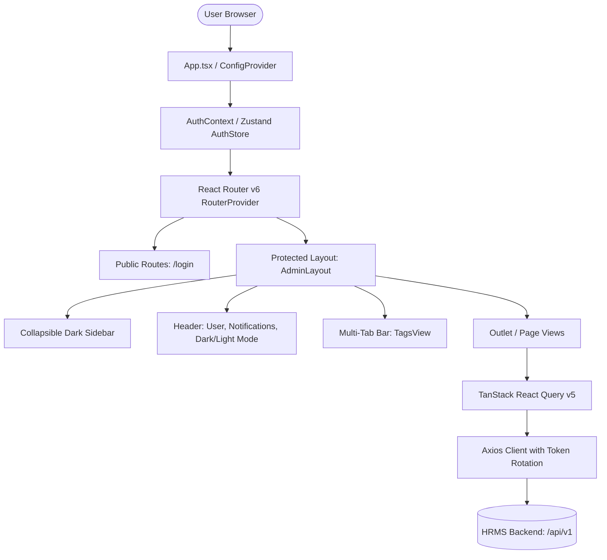

# HRMS Frontend Architecture Specification

## 1. Executive Summary
This document specifies the technical architecture for the Human Resources Management System (HRMS) frontend. The frontend is an enterprise-grade Single Page Application (SPA) built natively in **React 18+**, **TypeScript**, and **Ant Design 5**, inspired by the visual design and UX patterns of `vue3-antdv-admin`.

---

## 2. Technology Stack

| Layer | Technology | Version | Purpose |
| :--- | :--- | :--- | :--- |
| **Runtime & Build** | Vite + React | React 18+, Vite 5+ | Ultra-fast HMR, ES modules bundler |
| **Language** | TypeScript | 5.2+ | Strict typing, zero `any` policy |
| **Design System** | Ant Design 5 (`antd`) | 5.15+ | Enterprise UI components, tokens, theme engine |
| **Icons** | `@ant-design/icons` | 5.3+ | Native Ant Design SVG icon set |
| **Routing** | `react-router-dom` | 6.22+ | Declarative nested routing & RBAC guards |
| **Client State** | `zustand` | 4.5+ | Auth tokens, UI state, TagsView multi-tab tabs |
| **Server State** | `@tanstack/react-query` | 5.24+ | Server caching, pagination, optimistic updates |
| **Networking** | `axios` | 1.6+ | HTTP client with request/response interceptors |
| **Validation** | `zod` | 3.22+ | Client-side runtime schema validation |
| **Testing** | Vitest + RTL | Vitest 1.3+ | Component and unit test automation |
| **E2E Testing** | Playwright | Latest | Browser automation and critical path tests |

---

## 3. High-Level Architecture

---

## 4. Key Architectural Patterns

### 4.1 Token Storage & Refresh Architecture
1. **Access Token**: Stored in memory (Zustand store), securely injected into outgoing requests via Axios Request Interceptor (`Authorization: Bearer <token>`).
2. **Refresh Token**: Stored in browser storage (`localStorage`) as mandated by the backend JSON payload contract (`POST /api/v1/auth/refresh`).
3. **Concurrent 401 Interceptor**:
   - Uses a mutex / queue pattern.
   - When multiple API requests fail with `401 Unauthorized` simultaneously, only a single refresh call is triggered.
   - Queued requests await the new token and replay automatically.
   - If the refresh token has expired or is revoked, the session is cleared and the user is redirected to `/login`.

### 4.2 Declarative Role-Based Access Control (RBAC)
- The backend provides 7 roles: `HEAD_OF_HR`, `HR_RECRUITMENT`, `HR_ADMIN`, `HR_ATTENDANCE`, `HR_PAYROLL`, `HR_PERFORMANCE`, `HR_LND`.
- The user profile received at login contains `user.roles: string[]`.
- Each protected route is wrapped with a `<RoleGuard requiredRoles={[...]} />`.
- Menus in the sidebar automatically filter out inaccessible routes.
- Direct URL entry to an unauthorized path renders `<Forbidden403 />`.

### 4.3 Multi-Tab Navigation (TagsView)
- Modeled after `vue3-antdv-admin`.
- Opening a route adds a tab to `useTabStore`.
- Supports:
  - Active tab highlighting
  - Tab closing (`X` icon)
  - Context menu: *Close Others*, *Close All*, *Reload Current Tab*
  - Persistent tab history per session
