# HRMS Payroll Module — End-to-End Enterprise User Guide

Welcome to the comprehensive, step-by-step user manual for the **HRMS Payroll Module**. This guide walks you through the entire payroll lifecycle from initial system login to final executive approval, payslip generation, and reporting.

---

## Table of Contents
1. [System Access & Test Accounts](#1-system-access--test-accounts)
2. [Step 1: Logging In](#step-1-logging-in)
3. [Step 2: Navigating to Payroll Processing](#step-2-navigating-to-payroll-processing)
4. [Step 3: Creating a New Payroll Period](#step-3-creating-a-new-payroll-period)
5. [Step 4: Running Authoritative Calculation](#step-4-running-authoritative-calculation)
6. [Step 5: Inspecting Employee Calculations](#step-5-inspecting-employee-calculations)
7. [Step 6: Adding Manual Payroll Adjustments](#step-6-adding-manual-payroll-adjustments)
8. [Step 7: Viewing & Printing Official Payslips](#step-7-viewing--printing-official-payslips)
9. [Step 8: Pre-Submission Validation Scan](#step-8-pre-submission-validation-scan)
10. [Step 9: Submitting for Executive Sign-Off](#step-9-submitting-for-executive-sign-off)
11. [Step 10: Head of HR Approval or Rejection](#step-10-head-of-hr-approval-or-rejection)
12. [Step 11: Period Locking](#step-11-period-locking)
13. [Step 12: Executive Reports & Formula-Safe CSV Export](#step-12-executive-reports--formula-safe-csv-export)
14. [Step 13: Employee Self-Service Payslips](#step-13-employee-self-service-payslips)
15. [Troubleshooting & FAQ](#troubleshooting--faq)

---

## 1. System Access & Test Accounts

- **Application URL:** [http://localhost:5173](http://localhost:5173)
- **API Backend:** [http://localhost:3000/api/v1](http://localhost:3000/api/v1)

### Standard Credentials
All accounts share the default password: **`password123`**

| Role | Email | Permissions in Payroll |
| :--- | :--- | :--- |
| **`HR_PAYROLL`** *(Preparer)* | `payroll@hr.local` | Create periods, run calculations, add adjustments, review validation, submit periods. |
| **`HEAD_OF_HR`** *(Approver)* | `head@hr.local` | Full system access; exclusive authority to Approve, Reject, or Lock periods. |
| **General Staff** *(Self-Service)* | Any active employee | View personal payslips only under "My Payslips". |

> [!IMPORTANT]
> **Separation of Duties Policy**: To prevent fraudulent payroll modifications, preparers (`HR_PAYROLL`) cannot approve their own submissions. Only `HEAD_OF_HR` can approve or reject disbursements.

---

## Step 1: Logging In

1. Open your browser and navigate to [http://localhost:5173/login](http://localhost:5173/login).
2. Enter your email (e.g., `payroll@hr.local`) and password (`password123`).
3. Click **Sign In**.

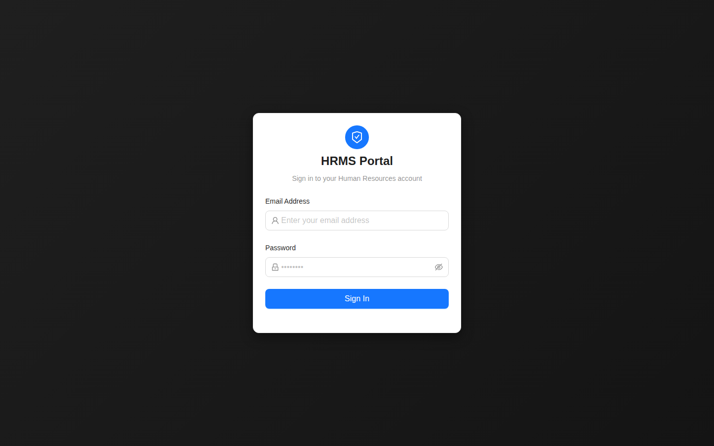

---

## Step 2: Navigating to Payroll Processing

Upon logging in, you will be directed to the main HRMS Dashboard.
1. Expand **Operations & Payroll** in the left sidebar navigation.
2. Click on **Payroll Processing**.

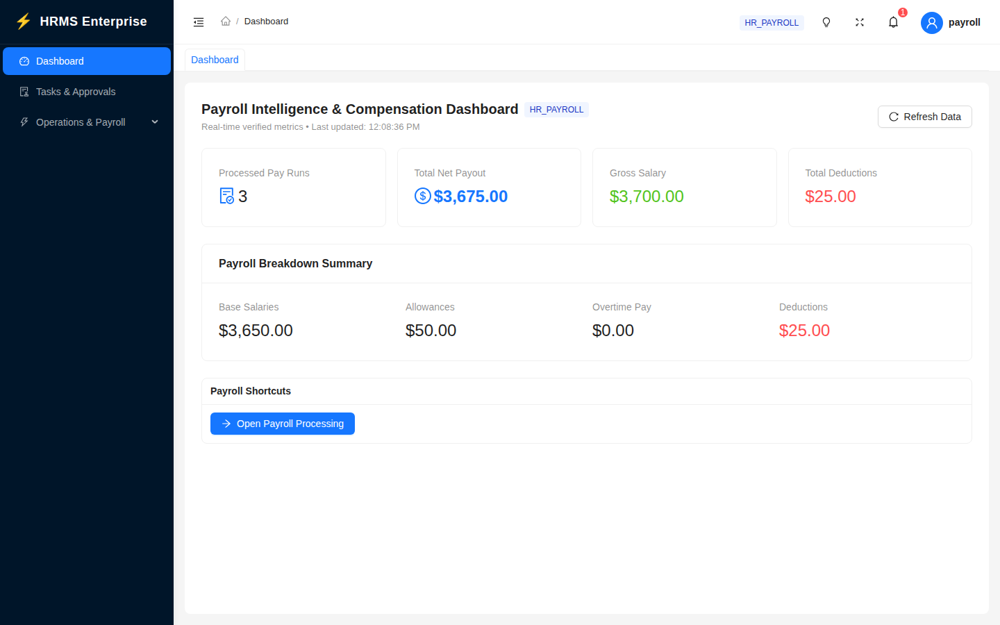

---

## Step 3: Creating a New Payroll Period

1. In the upper-right corner of the Payroll Processing header, click the blue **`+ New Payroll Period`** button.
2. In the modal dialog:
   - **Period Name**: Enter a descriptive name (e.g., `November 2026 Monthly Payroll`).
   - **Start Date**: Select the first calendar date of the cycle (e.g., `2026-11-01`).
   - **End Date**: Select the last calendar date of the cycle (e.g., `2026-11-30`).
3. Click **Create Period**.

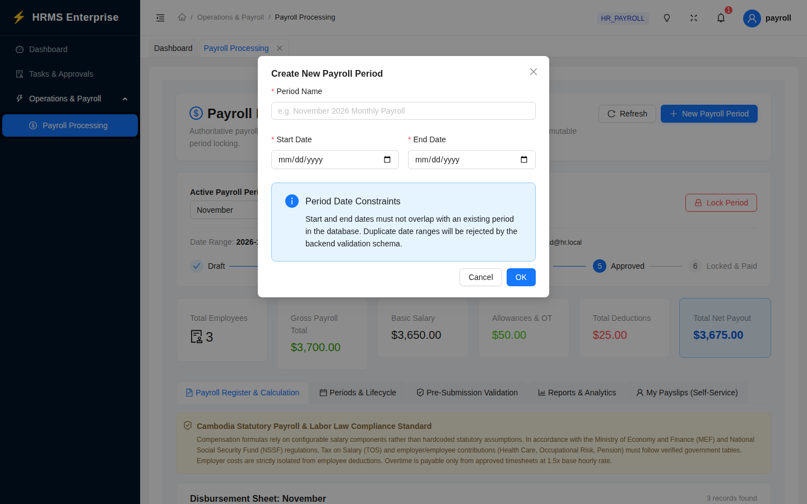

> [!NOTE]
> The backend enforces a unique constraint on `(startDate, endDate)`. Duplicate dates for the same cycle will be rejected with an alert.

---

## Step 4: Running Authoritative Calculation

1. Select your desired period from the **Active Payroll Period** dropdown selector.
2. Click the **`Calculate Payroll`** (or **`Recalculate Payroll`**) button located in the controller bar.
3. Confirm the action in the prompt.
4. The backend transaction runs:
   - Reads active employee compensation profiles.
   - Computes base salaries ($Basic$).
   - Pulls approved overtime from attendance timesheets ($Overtime = \frac{Basic}{160} \times 1.5 \times Hours$).
   - Sums recurring allowances and statutory deductions.
   - Computes Gross Pay and Net Payout.
5. The 6 KPI summary cards and the disbursement register table update immediately with authoritative figures.

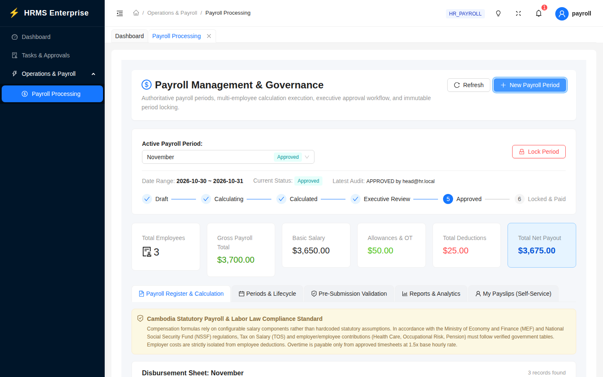

---

## Step 5: Inspecting Employee Calculations

To audit how an employee's salary was calculated down to the cent:
1. Locate the employee row in the **Disbursement Sheet** table.
2. Click the **`Inspect`** button.
3. The **Payroll Calculation Inspector** drawer opens on the right side:
   - **Contractual Base Salary & Hourly Standard**: Displays base salary, the 160-hour monthly divisor, base hourly rate, and $1.5\times$ overtime rate.
   - **Overtime Pay Derivation**: Displays approved timesheet overtime hours and earnings.
   - **Component Breakdown**: Line-by-line listing of allowances, bonuses, and deductions.
   - **Gross-to-Net Reconciliation**: Complete mathematical breakdown of earnings minus deductions.

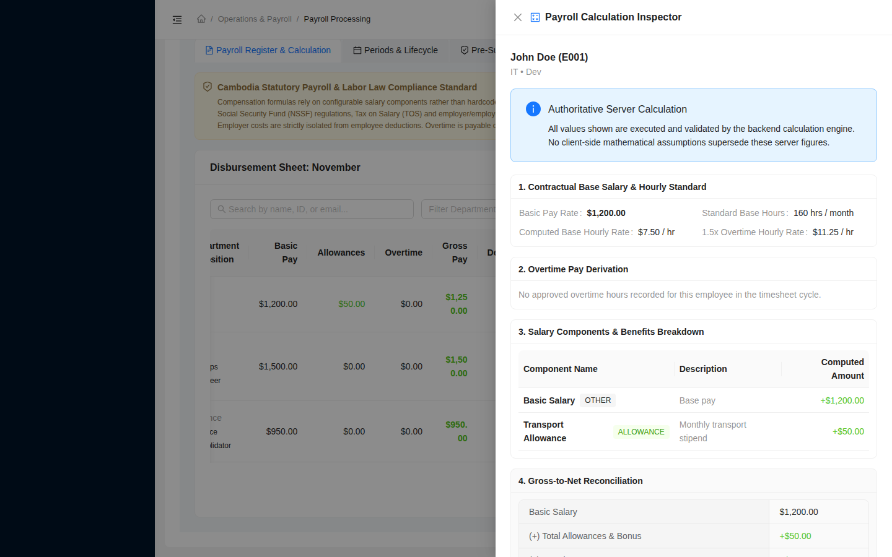

---

## Step 6: Adding Manual Payroll Adjustments

If an employee is owed a discretionary bonus or must be charged a one-time deduction:
1. In the employee's table row, click **`Adjustment`**.
2. In the **Add Adjustment** modal:
   - **Category**: Select `BONUS`, `DEDUCTION`, or `ALLOWANCE`.
   - **Amount**: Enter the dollar amount (e.g., `100.00`).
   - **Description / Reason**: Provide an auditable reason (e.g., `Q4 Performance Bonus` or `Laptop damage surcharge`).
3. Click **Save Adjustment**.
4. The employee's gross, deductions, and net salary recalculate automatically.

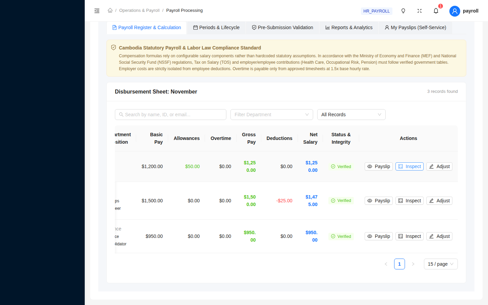

---

## Step 7: Viewing & Printing Official Payslips

1. In the employee's row, click **`Payslip`**.
2. The **Official Employee Payslip** drawer slides out:
   - Displays company letterhead, employee code, department, and role.
   - Lists contractual basic salary, allowances, overtime, and deductions.
   - Shows the net payout in clear bold highlight.
3. Click the blue **`Print Payslip`** button in the top right corner to generate an official printout or PDF.

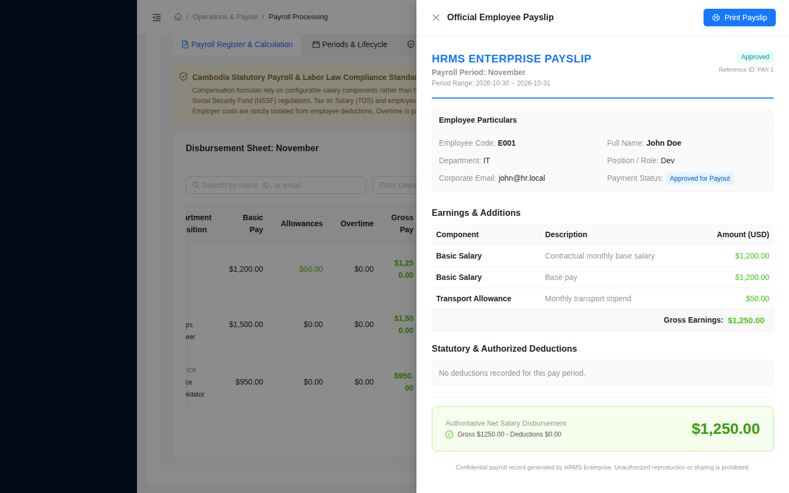

---

## Step 8: Pre-Submission Validation Scan

Before you can submit payroll to executive leadership, click the **Pre-Submission Validation** tab.

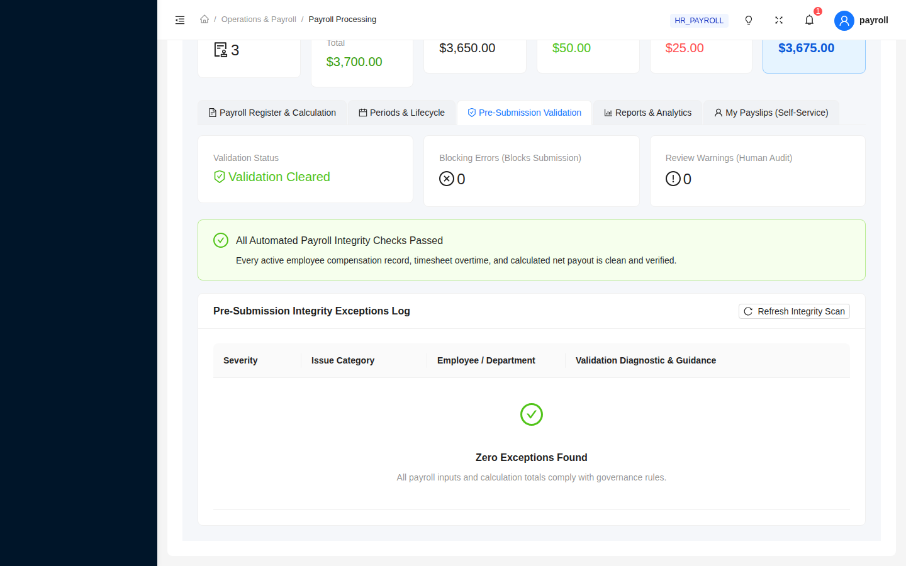

The automated integrity engine checks:
- **Blocking Errors** (Red):
  - Any active employee missing a compensation record.
  - Calculated net payout $\le \$0.00$.
  - Duplicate payroll records for an employee.
  > [!CAUTION]
  > The **Submit for Review** button is automatically disabled until all blocking errors are cleared.
- **Review Warnings** (Orange):
  - Excessive overtime hours ($> 30\text{ hours}$).
  - Deduction ratio exceeding $50\%$ of gross wages.

---

## Step 9: Submitting for Executive Sign-Off

1. Once the validation tab displays **Validation Cleared** (0 blocking errors), return to the **Payroll Register** tab.
2. Click the blue **`Submit for Review`** button.
3. Confirm the popconfirm dialog: *"Submit calculated payroll figures to Head of HR for final approval?"*
4. The period status transitions to **`PENDING_APPROVAL`**.
5. Routine calculations and modifications are now locked pending executive sign-off.

---

## Step 10: Head of HR Approval or Rejection

1. Log out and sign in as **`head@hr.local`** (`password123`).
2. Go to **Payroll Processing**.
3. A blue alert banner notifies you: *"Executive Action Required: 1 Payroll Period(s) Pending Final Approval"*.
4. Inspect the summary figures and the employee register.
5. **To Approve**: Click the green **`Approve Payroll`** button. The period status advances to `APPROVED`.
6. **To Reject**: Click the red **`Reject Payroll`** button. A modal opens requiring mandatory written justification. Upon rejection, the period returns to `REJECTED`, allowing the payroll officer to make corrections.

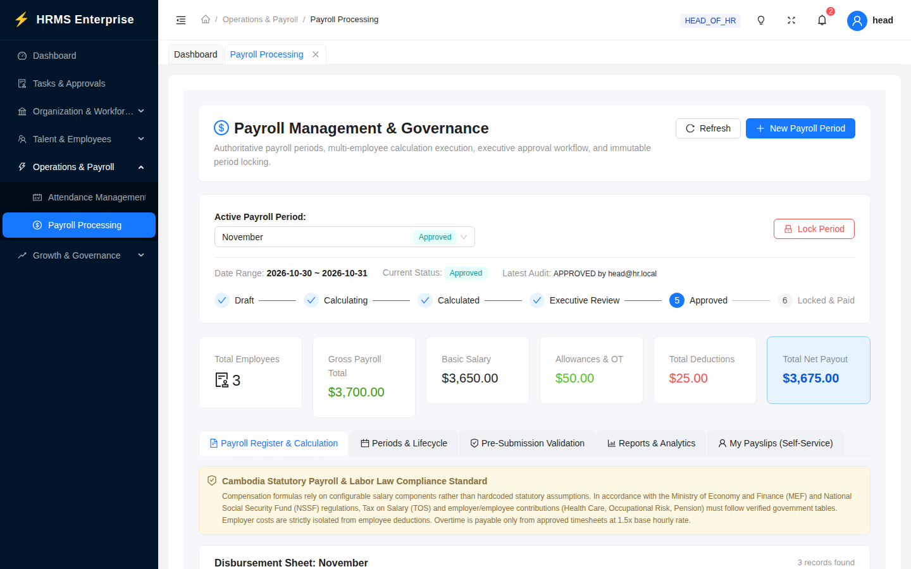

---

## Step 11: Period Locking

1. Once a period is in `APPROVED` status, the **`Lock Period`** button becomes active.
2. Click **Lock Period** and confirm the high-impact caution dialog.
3. The period advances to **`LOCKED`**.
4. All calculation triggers, adjustments, and submission buttons are disabled permanently. The period is archived for financial and tax auditing.

---

## Step 12: Executive Reports & Formula-Safe CSV Export

Click the **Reports & Analytics** tab to view department summaries and generate financial exports.

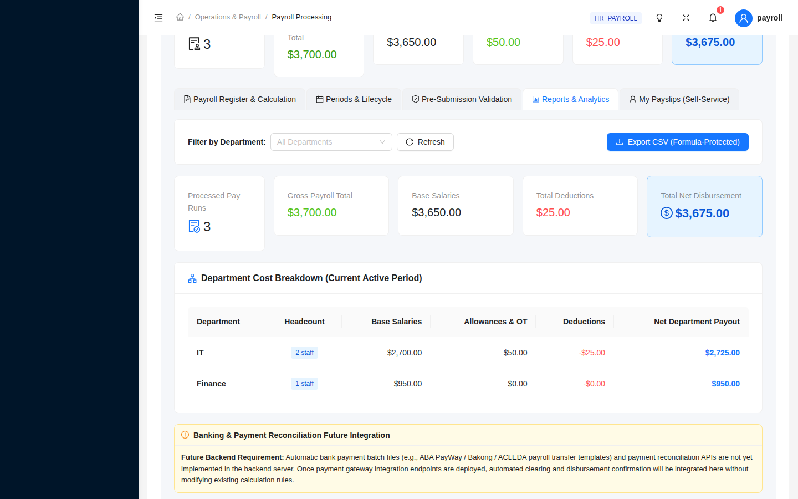

### Key Features:
- **Department Cost Breakdown**: Lists total headcount, gross cost, total deductions, and net payout per department.
- **Department Filter**: Drill down into specific cost centers (e.g., IT, Finance, Operations).
- **Export Payroll CSV**: Click **Export Payroll CSV**.
  - All numeric and text cells are sanitized with **Spreadsheet Formula Injection Defense** (cells starting with `=`, `+`, `-`, `@`, `\t`, `\r` are prefixed with `'`) to protect accounting spreadsheets.

---

## Step 13: Employee Self-Service Payslips

Standard employees can log in with their own accounts and navigate to the **My Payslips** tab.

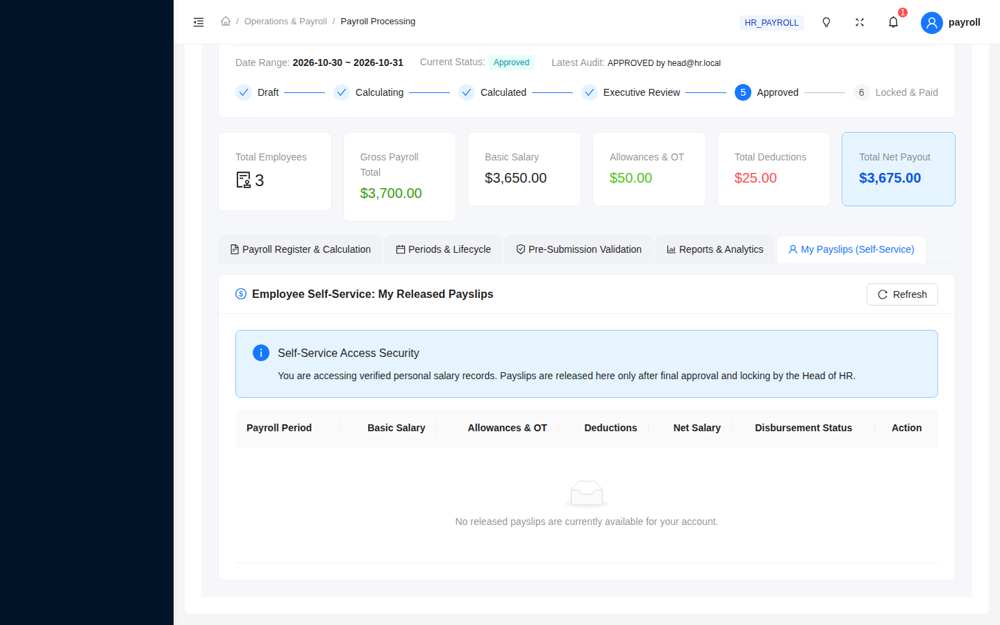

- Queries `GET /api/v1/payroll/payslips/my`.
- Strictly enforces object-level access: employees can only view and print their own payslips.
- Attempts to query another employee's records return HTTP 403 Forbidden.

---

## Troubleshooting & FAQ

### Q: Why do I not see the "+ New Payroll Period" or "Calculate" buttons?
**Answer**: Action buttons are role-restricted. Ensure you are signed in as **`payroll@hr.local`** or **`head@hr.local`**. Other roles (e.g. `admin@hr.local`, `recruiter@hr.local`, or regular employees) do not have payroll calculation permissions.

### Q: Why is the "Submit for Review" button disabled or missing?
**Answer**:
1. The payroll period must be in `CALCULATED` status.
2. The period must have at least 1 calculated employee record.
3. Check the **Pre-Submission Validation** tab: if there are any blocking errors (such as an employee with missing compensation or net payout $\le 0$), submission is blocked until resolved.

### Q: What is the overtime calculation formula?
**Answer**: Following standard labor conventions:
$$\text{Hourly Base} = \frac{\text{Contractual Basic Salary}}{160\text{ hours}}$$
$$\text{Overtime Pay} = \text{Hourly Base} \times 1.5 \times \text{Approved Overtime Hours}$$
Only overtime requests approved by attendance managers in timesheets are factored into the calculation.
